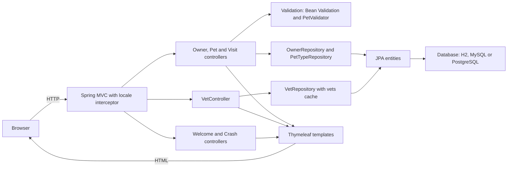
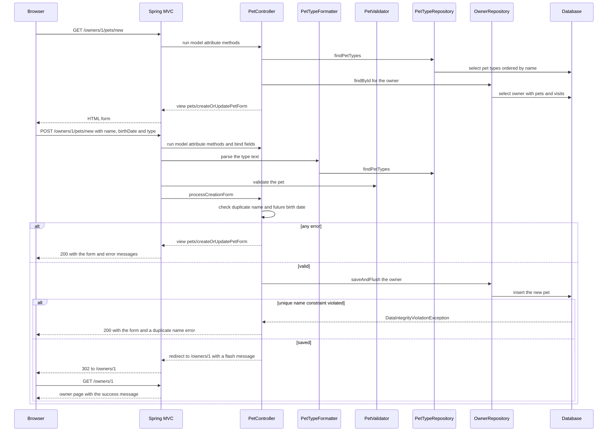

# Codebase analysis

Findings are based on source code, configuration and a resolved Maven dependency tree (`mvn dependency:tree`). The README was treated as a set of claims to check, not as evidence. The application was not run. Links point at the file and line in this repository, relative to `docs/`.

## Table of contents

1. [Purpose and main features](#purpose-and-main-features)
2. [Technology stack](#technology-stack)
3. [Startup process](#startup-process)
4. [Entry points and request handling](#entry-points-and-request-handling)
5. [Architecture](#architecture)
6. [Data flow](#data-flow)
7. [Design decisions](#design-decisions)
8. [Concerns](#concerns)
9. [Feature trace: Add New Pet](#feature-trace-add-new-pet)
10. [Runbook](#runbook)
11. [Open questions](#open-questions)

---

## Purpose and main features

**Purpose.** A server-rendered web application for a veterinary clinic ("PetClinic"). It is the Spring PetClinic sample application: the artifact is `spring-petclinic` ([pom.xml:12](../pom.xml#L12)) and the page title and nav labels come from i18n messages ([layout.html:12](../src/main/resources/templates/fragments/layout.html#L12)). There is no authentication or authorization code: a search for "security" in the repository found nothing outside the Maven and Gradle wrapper scripts, and the stack has no Spring Security dependency ([pom.xml:42-65](../pom.xml#L42-L65)).

**Main features** (each is a controller in `src/main/java/org/springframework/samples/petclinic`):

| Feature | What it does | Source |
|---|---|---|
| Home page | Renders the `welcome` view. | [WelcomeController.java:25-28](../src/main/java/org/springframework/samples/petclinic/system/WelcomeController.java#L25-L28) |
| Find owners | Search form, then a search by last-name prefix. Results are paged 5 per page. One match redirects straight to that owner. No match shows "not found" on the form. | [OwnerController.java:89-146](../src/main/java/org/springframework/samples/petclinic/owner/OwnerController.java#L89-L146) |
| Create / edit owner | Form GET and POST with bean validation (`@Valid`). | [OwnerController.java:72-87](../src/main/java/org/springframework/samples/petclinic/owner/OwnerController.java#L72-L87), [:148-171](../src/main/java/org/springframework/samples/petclinic/owner/OwnerController.java#L148-L171) |
| Owner details | Shows one owner. | [OwnerController.java:178-186](../src/main/java/org/springframework/samples/petclinic/owner/OwnerController.java#L178-L186) |
| Add / edit pet | Under an owner. Rejects a duplicate name for the same owner and a birth date in the future. | [PetController.java:100-179](../src/main/java/org/springframework/samples/petclinic/owner/PetController.java#L100-L179) |
| Book a visit | For a pet. The date must be after today. | [VisitController.java:90-112](../src/main/java/org/springframework/samples/petclinic/owner/VisitController.java#L90-L112) |
| Veterinarians list | Paged HTML list (5 per page) at `/vets.html`. A second endpoint, `/vets`, returns an object directly as the response body (`@ResponseBody`). | [VetController.java:45-79](../src/main/java/org/springframework/samples/petclinic/vet/VetController.java#L45-L79) |
| Error demo | `/oups` always throws a `RuntimeException`, so the error page can be seen. The nav bar links to it. | [CrashController.java:31-35](../src/main/java/org/springframework/samples/petclinic/system/CrashController.java#L31-L35), [layout.html:56-57](../src/main/resources/templates/fragments/layout.html#L56-L57) |
| Language switch | Any request can carry `?lang=xx`. The choice is remembered in the session and defaults to English. Message bundles exist for de, en, es, fa, hi, ja, ko, pt, ru and tr. | [WebConfiguration.java:32-58](../src/main/java/org/springframework/samples/petclinic/system/WebConfiguration.java#L32-L58), [messages/](../src/main/resources/messages/) |
| Operational endpoints | Spring Boot Actuator, with every web endpoint exposed. | [application.properties:21](../src/main/resources/application.properties#L21) |

---

## Technology stack

| Area | Technology | Evidence |
|---|---|---|
| Language / JDK | Java 17 minimum | [pom.xml:19](../pom.xml#L19), [build.gradle:19](../build.gradle#L19) |
| Framework | Spring Boot 4.1.0, taken from the Boot parent POM | [pom.xml:5-9](../pom.xml#L5-L9) |
| Web | `spring-boot-starter-webmvc` (Spring MVC). The resolved tree includes embedded Tomcat 11.0.22. | [pom.xml:62-65](../pom.xml#L62-L65) |
| View layer | Thymeleaf 3.1.5, HTML mode, with a shared layout fragment | [pom.xml:54-57](../pom.xml#L54-L57), [application.properties:7](../src/main/resources/application.properties#L7), [layout.html:3](../src/main/resources/templates/fragments/layout.html#L3) |
| Front-end assets | Bootstrap 5.3.8 and Font Awesome 4.7.0 as WebJars, plus `petclinic.css` compiled from SCSS. The SCSS build is only the opt-in Maven profile `css`. | [pom.xml:26-28](../pom.xml#L26-L28), [pom.xml:322-372](../pom.xml#L322-L372), [src/main/scss/](../src/main/scss/) |
| Persistence | Spring Data JPA, Hibernate 7.4.1. The schema is created from SQL scripts, not by Hibernate (`ddl-auto=none`). | [pom.xml:50-53](../pom.xml#L50-L53), [application.properties:2-4,10-13](../src/main/resources/application.properties#L2-L13) |
| Databases | H2 in memory (default), MySQL and PostgreSQL via the profiles `mysql` and `postgres`. Drivers for all three are on the runtime classpath. | [pom.xml:76-95](../pom.xml#L76-L95), [application-mysql.properties](../src/main/resources/application-mysql.properties), [application-postgres.properties](../src/main/resources/application-postgres.properties) |
| Validation | Jakarta Bean Validation with Hibernate Validator 9.1.0, plus a custom `PetValidator` | [pom.xml:58-61](../pom.xml#L58-L61), [PetController.java:94-98](../src/main/java/org/springframework/samples/petclinic/owner/PetController.java#L94-L98) |
| Caching | Spring Cache with the JCache API (`javax.cache:cache-api`). Caffeine is on the runtime classpath. One cache is declared, named `vets`. | [pom.xml:46-49,67-70,81-85](../pom.xml#L46-L49), [CacheConfiguration.java:31-38](../src/main/java/org/springframework/samples/petclinic/system/CacheConfiguration.java#L31-L38), [VetRepository.java:44-56](../src/main/java/org/springframework/samples/petclinic/vet/VetRepository.java#L44-L56) |
| i18n | Message bundles under `messages/messages*.properties` | [application.properties:16](../src/main/resources/application.properties#L16) |
| Monitoring | Spring Boot Actuator. Build-info, git-properties and CycloneDX SBOM plugins feed it. | [pom.xml:42-45](../pom.xml#L42-L45), [pom.xml:255-312](../pom.xml#L255-L312) |
| JSON / XML | Jackson 3 (`tools.jackson`) is on the classpath. `jakarta.xml.bind-api` is also declared. | [pom.xml:71-74](../pom.xml#L71-L74), [Vets.java:30-36](../src/main/java/org/springframework/samples/petclinic/vet/Vets.java#L30-L36) |
| Native image | GraalVM native-build plugin and AOT runtime hints | [pom.xml:251-254](../pom.xml#L251-L254), [PetClinicRuntimeHints.java:25-36](../src/main/java/org/springframework/samples/petclinic/PetClinicRuntimeHints.java#L25-L36) |
| Dev tooling | Spring Boot DevTools (optional), Spring Java Format and Checkstyle in the `validate` phase, JaCoCo | [pom.xml:115-119](../pom.xml#L115-L119), [pom.xml:205-250](../pom.xml#L205-L250), [pom.xml:276-294](../pom.xml#L276-L294) |
| Tests | JUnit with Spring Boot test starters, Testcontainers (MySQL) and Docker Compose support. Tests live in `src/test/java`. | [pom.xml:121-180](../pom.xml#L121-L180) |
| Build tools | Maven ([pom.xml](../pom.xml)) and Gradle ([build.gradle](../build.gradle)), both maintained | |

---

## Startup process

1. **Entry point.** `PetClinicApplication.main` calls `SpringApplication.run(PetClinicApplication.class, args)` ([PetClinicApplication.java:32-34](../src/main/java/org/springframework/samples/petclinic/PetClinicApplication.java#L32-L34)).
2. **Auto-configuration and component scan.** `@SpringBootApplication` ([PetClinicApplication.java:28](../src/main/java/org/springframework/samples/petclinic/PetClinicApplication.java#L28)) scans `org.springframework.samples.petclinic` and its sub-packages. It registers:
   - the controllers, `OwnerController`, `PetController`, `VisitController`, `VetController`, `WelcomeController` and `CrashController`;
   - the `@Configuration` classes [WebConfiguration](../src/main/java/org/springframework/samples/petclinic/system/WebConfiguration.java#L23) and [CacheConfiguration](../src/main/java/org/springframework/samples/petclinic/system/CacheConfiguration.java#L31-L33);
   - the Spring Data repositories ([OwnerRepository](../src/main/java/org/springframework/samples/petclinic/owner/OwnerRepository.java#L36), [VetRepository](../src/main/java/org/springframework/samples/petclinic/vet/VetRepository.java#L38), PetTypeRepository).

   Auto-configuration then sets up the embedded web server, Spring MVC, Thymeleaf, JPA and Actuator from the starters in the POM. This part is standard Spring Boot behaviour and is not spelled out in this repo's code.
3. **Native-image hints.** `@ImportRuntimeHints(PetClinicRuntimeHints.class)` ([PetClinicApplication.java:29](../src/main/java/org/springframework/samples/petclinic/PetClinicApplication.java#L29)) registers resource patterns (`db/*`, `messages/*`) and Java-serialization reflection hints for `BaseEntity`, `Person` and `Vet` ([PetClinicRuntimeHints.java:27-35](../src/main/java/org/springframework/samples/petclinic/PetClinicRuntimeHints.java#L27-L35)). These matter for AOT and native builds.
4. **Configuration loaded.** `application.properties` sets `database=h2` and builds the SQL init script paths from it ([application.properties:2-4](../src/main/resources/application.properties#L2-L4)). The `mysql` or `postgres` profile overrides `database` and sets the datasource URL, user and password. The URL, user and password come from environment variables with defaults, and `spring.sql.init.mode=always` is set ([application-mysql.properties:2-7](../src/main/resources/application-mysql.properties#L2-L7), [application-postgres.properties:2-7](../src/main/resources/application-postgres.properties#L2-L7)).
5. **Database initialisation.** With `ddl-auto=none` ([application.properties:10](../src/main/resources/application.properties#L10)), Spring runs `db/<database>/schema.sql` and then `data.sql` ([h2](../src/main/resources/db/h2/schema.sql), [mysql](../src/main/resources/db/mysql/schema.sql), [postgres](../src/main/resources/db/postgres/schema.sql)). For the default embedded H2 database this happens on every start. For MySQL and PostgreSQL it is forced by `spring.sql.init.mode=always`.
6. **Beans declared in code.**
   - A session-based `LocaleResolver` with English as the default, and a `LocaleChangeInterceptor` on the `lang` parameter, registered as an interceptor ([WebConfiguration.java:32-58](../src/main/java/org/springframework/samples/petclinic/system/WebConfiguration.java#L32-L58)).
   - `@EnableCaching` and a `JCacheManagerCustomizer` that creates the `vets` cache with statistics enabled ([CacheConfiguration.java:32-38](../src/main/java/org/springframework/samples/petclinic/system/CacheConfiguration.java#L32-L38)).
7. **Ready.** Once the context is up, the embedded server accepts HTTP requests. The README says port 8080 ([README.md:36](../README.md#L36)). No `server.port` setting appears in the properties files, so 8080 is the Spring Boot default.

---

## Entry points and request handling

**Process entry point:** [PetClinicApplication.main](../src/main/java/org/springframework/samples/petclinic/PetClinicApplication.java#L32). This is a request/response web app. A search for `@Scheduled`, message listeners and event listeners found no background jobs, queue consumers or other event entry points.

**HTTP entry points** (all `@Controller` classes, handled by Spring MVC):

| Method and path | Handler | Result |
|---|---|---|
| `GET /` | [WelcomeController.welcome](../src/main/java/org/springframework/samples/petclinic/system/WelcomeController.java#L25) | view `welcome` |
| `GET /oups` | [CrashController.triggerException](../src/main/java/org/springframework/samples/petclinic/system/CrashController.java#L31) | throws `RuntimeException` |
| `GET /owners/find` | [OwnerController.initFindForm](../src/main/java/org/springframework/samples/petclinic/owner/OwnerController.java#L89) | view `owners/findOwners` |
| `GET /owners?page=&lastName=` | [processFindForm](../src/main/java/org/springframework/samples/petclinic/owner/OwnerController.java#L94) | list view, redirect to the owner, or back to the form |
| `GET`, `POST /owners/new` | [initCreationForm](../src/main/java/org/springframework/samples/petclinic/owner/OwnerController.java#L72), [processCreationForm](../src/main/java/org/springframework/samples/petclinic/owner/OwnerController.java#L77) | form, then redirect to `/owners/{id}` |
| `GET /owners/{ownerId}` | [showOwner](../src/main/java/org/springframework/samples/petclinic/owner/OwnerController.java#L178) | view `owners/ownerDetails` |
| `GET`, `POST /owners/{ownerId}/edit` | [initUpdateOwnerForm](../src/main/java/org/springframework/samples/petclinic/owner/OwnerController.java#L148), [processUpdateOwnerForm](../src/main/java/org/springframework/samples/petclinic/owner/OwnerController.java#L153) | form, then redirect |
| `GET`, `POST /owners/{ownerId}/pets/new` | [PetController](../src/main/java/org/springframework/samples/petclinic/owner/PetController.java#L100) (class mapping at [:48](../src/main/java/org/springframework/samples/petclinic/owner/PetController.java#L48)) | form, then redirect to the owner |
| `GET`, `POST /owners/{ownerId}/pets/{petId}/edit` | [PetController](../src/main/java/org/springframework/samples/petclinic/owner/PetController.java#L139) | form, then redirect to the owner |
| `GET`, `POST /owners/{ownerId}/pets/{petId}/visits/new` | [VisitController](../src/main/java/org/springframework/samples/petclinic/owner/VisitController.java#L90) | form, then redirect to the owner |
| `GET /vets.html?page=` | [VetController.showVetList](../src/main/java/org/springframework/samples/petclinic/vet/VetController.java#L45) | view `vets/vetList` |
| `GET /vets` | [VetController.showResourcesVetList](../src/main/java/org/springframework/samples/petclinic/vet/VetController.java#L72) | `Vets` object as the response body |
| Actuator endpoints | Boot Actuator, with every web endpoint exposed ([application.properties:21](../src/main/resources/application.properties#L21)) | not defined in this repo's code |
| Static files | `/resources/**` from [static/resources](../src/main/resources/static/resources/), with a 12-hour max-age ([application.properties:29](../src/main/resources/application.properties#L29)). Bootstrap and Font Awesome are served as WebJars under `/webjars/**` ([layout.html:13,84](../src/main/resources/templates/fragments/layout.html#L13)). | |

**How a request is handled** (the standard Spring Boot MVC pipeline, with the repo-specific steps called out):

1. Spring MVC routes the request to a `@Controller` method by its `@GetMapping` or `@PostMapping`.
2. `LocaleChangeInterceptor` runs on every request and reads the `lang` parameter ([WebConfiguration.java:55-58](../src/main/java/org/springframework/samples/petclinic/system/WebConfiguration.java#L55-L58)).
3. Before the handler runs, `@ModelAttribute` methods load the objects the handler needs, and `@InitBinder` methods configure data binding.
   - `OwnerController` loads the owner by `ownerId`, or creates a new one ([:64-70](../src/main/java/org/springframework/samples/petclinic/owner/OwnerController.java#L64-L70)).
   - `PetController` loads the owner, the pet and the pet types ([:62-87](../src/main/java/org/springframework/samples/petclinic/owner/PetController.java#L62-L87)).
   - `VisitController` loads the owner and pet and attaches a new `Visit` ([:63-81](../src/main/java/org/springframework/samples/petclinic/owner/VisitController.java#L63-L81)).
   - All of the above forbid binding the `id` and `*.id` form fields ([OwnerController.java:59-62](../src/main/java/org/springframework/samples/petclinic/owner/OwnerController.java#L59-L62), [PetController.java:89-98](../src/main/java/org/springframework/samples/petclinic/owner/PetController.java#L89-L98), [VisitController.java:51-54](../src/main/java/org/springframework/samples/petclinic/owner/VisitController.java#L51-L54)).
4. Form POSTs bind to the model object and validate it with `@Valid` and `BindingResult`. Pets also use `PetValidator`. If there are errors, the form view is re-rendered. Otherwise the controller saves through the repository and redirects to the details page with a flash message (for example [OwnerController.java:77-87](../src/main/java/org/springframework/samples/petclinic/owner/OwnerController.java#L77-L87)).
5. The controllers talk to Spring Data repositories directly: `OwnerRepository` ([OwnerRepository.java:36-62](../src/main/java/org/springframework/samples/petclinic/owner/OwnerRepository.java#L36-L62)), `PetTypeRepository` and `VetRepository`. There is no service layer in `src/main`. The vet queries are marked `@Cacheable("vets")` and `@Transactional(readOnly = true)` ([VetRepository.java:44-56](../src/main/java/org/springframework/samples/petclinic/vet/VetRepository.java#L44-L56)).
6. The returned view name is rendered by Thymeleaf from `templates/`. Pages wrap themselves in the shared layout ([welcome.html:3](../src/main/resources/templates/welcome.html#L3), [layout.html:3,69](../src/main/resources/templates/fragments/layout.html#L3)).
7. **Errors.** The repo has no `@ControllerAdvice` or `@ExceptionHandler`. Missing owners and pets throw `IllegalArgumentException` ([OwnerController.java:68](../src/main/java/org/springframework/samples/petclinic/owner/OwnerController.java#L68), [VisitController.java:72](../src/main/java/org/springframework/samples/petclinic/owner/VisitController.java#L72)), and `/oups` throws `RuntimeException`. These are left to Spring Boot's default error handling. [error.html](../src/main/resources/templates/error.html#L3) is the custom page. It shows a message by `status` (404, 500, other) and the exception `message` ([error.html:11-18](../src/main/resources/templates/error.html#L11-L18)). Wiring that page to Boot's `/error` is framework behaviour and is not shown in the repo's code.

---

## Architecture

The application is a single deployable Spring Boot unit with three layers: controllers, Spring Data repositories, and JPA entities. There is no service layer and no separate API module. The only other pieces are Thymeleaf templates for the views, and one cache in front of the vet queries.



**Components and dependencies** (all confirmed by imports and constructors):

| Component | Depends on | Source |
|---|---|---|
| `OwnerController` | `OwnerRepository` | [OwnerController.java:53-57](../src/main/java/org/springframework/samples/petclinic/owner/OwnerController.java#L53-L57) |
| `PetController` | `OwnerRepository`, `PetTypeRepository`, `PetValidator` | [PetController.java:53-60](../src/main/java/org/springframework/samples/petclinic/owner/PetController.java#L53-L60), [:96](../src/main/java/org/springframework/samples/petclinic/owner/PetController.java#L96) |
| `VisitController` | `OwnerRepository` | [VisitController.java:45-49](../src/main/java/org/springframework/samples/petclinic/owner/VisitController.java#L45-L49) |
| `VetController` | `VetRepository` | [VetController.java:39-43](../src/main/java/org/springframework/samples/petclinic/vet/VetController.java#L39-L43) |
| `WelcomeController`, `CrashController` | none | [WelcomeController.java:22-23](../src/main/java/org/springframework/samples/petclinic/system/WelcomeController.java#L22-L23), [CrashController.java:28-29](../src/main/java/org/springframework/samples/petclinic/system/CrashController.java#L28-L29) |
| `PetTypeFormatter` (a Spring MVC `Formatter`, so it is called when form text is converted to a `PetType`) | `PetTypeRepository` | [PetTypeFormatter.java:36-43](../src/main/java/org/springframework/samples/petclinic/owner/PetTypeFormatter.java#L36-L43) |
| `OwnerRepository` | `JpaRepository<Owner, Integer>`, with a derived query `findByLastNameStartingWith` | [OwnerRepository.java:36-45](../src/main/java/org/springframework/samples/petclinic/owner/OwnerRepository.java#L36-L45) |
| `PetTypeRepository` | `JpaRepository<PetType, Integer>`, with a JPQL query ordered by name | [PetTypeRepository.java:30-37](../src/main/java/org/springframework/samples/petclinic/owner/PetTypeRepository.java#L30-L37) |
| `VetRepository` | plain `Repository<Vet, Integer>` exposing only the two read methods `findAll()` and `findAll(Pageable)`, both cached | [VetRepository.java:38-56](../src/main/java/org/springframework/samples/petclinic/vet/VetRepository.java#L38-L56) |
| Entities | `Owner` and `Vet` extend `Person`, and `Pet` and `PetType` extend `NamedEntity`. `Visit` extends `BaseEntity`. | [Person.java:29](../src/main/java/org/springframework/samples/petclinic/model/Person.java#L29), [BaseEntity.java:32-37](../src/main/java/org/springframework/samples/petclinic/model/BaseEntity.java#L32-L37), [Owner.java:50](../src/main/java/org/springframework/samples/petclinic/owner/Owner.java#L50), [Pet.java:46](../src/main/java/org/springframework/samples/petclinic/owner/Pet.java#L46), [Vet.java:45](../src/main/java/org/springframework/samples/petclinic/vet/Vet.java#L45) |

**Package boundaries.** Code is grouped by feature: `owner` holds owners, pets, visits and pet types, `vet` holds vets and specialties, `system` holds configuration and the demo controllers, and `model` holds shared base classes. A search of all `import org.springframework.samples...` lines shows that `owner` and `vet` import only from `model` and not from each other. The only other cross-package reference is `PetClinicRuntimeHints`, which names classes from `model` and `vet` ([PetClinicRuntimeHints.java:21-23](../src/main/java/org/springframework/samples/petclinic/PetClinicRuntimeHints.java#L21-L23)).

**Aggregate shape.** `Owner` is the root: it holds the pets, and each `Pet` holds its visits. Both associations use `CascadeType.ALL` and `FetchType.EAGER` ([Owner.java:67-70](../src/main/java/org/springframework/samples/petclinic/owner/Owner.java#L67-L70), [Pet.java:56-59](../src/main/java/org/springframework/samples/petclinic/owner/Pet.java#L56-L59)). There is no repository for `Pet` or `Visit`, so pets and visits are only saved by saving their owner. `Pet` points to a `PetType` ([Pet.java:52-54](../src/main/java/org/springframework/samples/petclinic/owner/Pet.java#L52-L54)). `Vet` has its own eager many-to-many with `Specialty` ([Vet.java:47-50](../src/main/java/org/springframework/samples/petclinic/vet/Vet.java#L47-L50)).

---

## Data flow

**Inbound: binding and conversion.**
1. Form fields and query parameters are bound onto the model object that a `@ModelAttribute` method supplies. The controllers bind straight onto the JPA entities (`Owner`, `Pet`, `Visit`). There are no separate form or DTO classes in `src/main`.
2. Each binder disallows `id` and `*.id` so the form cannot overwrite identity ([OwnerController.java:59-62](../src/main/java/org/springframework/samples/petclinic/owner/OwnerController.java#L59-L62), [PetController.java:89-98](../src/main/java/org/springframework/samples/petclinic/owner/PetController.java#L89-L98), [VisitController.java:51-54](../src/main/java/org/springframework/samples/petclinic/owner/VisitController.java#L51-L54)).
3. Dates are parsed as `yyyy-MM-dd` ([Pet.java:49](../src/main/java/org/springframework/samples/petclinic/owner/Pet.java#L49), [Visit.java:40](../src/main/java/org/springframework/samples/petclinic/owner/Visit.java#L40)). The pet type arrives as text and `PetTypeFormatter` looks it up by name through `PetTypeRepository`. An unknown name throws `ParseException` ([PetTypeFormatter.java:51-60](../src/main/java/org/springframework/samples/petclinic/owner/PetTypeFormatter.java#L51-L60)).

**Validation, in the order it is applied on a POST:**

| Stage | Rule | Source |
|---|---|---|
| Bean Validation on entities (`@Valid`) | `firstName` and `lastName` are required and at most 30 characters. `address` is required and at most 255. `city` is required and at most 80. `telephone` is required and must be exactly 10 digits. A visit `description` is required and at most 255. | [Person.java:31-39](../src/main/java/org/springframework/samples/petclinic/model/Person.java#L31-L39), [Owner.java:52-65](../src/main/java/org/springframework/samples/petclinic/owner/Owner.java#L52-L65), [Visit.java:43-45](../src/main/java/org/springframework/samples/petclinic/owner/Visit.java#L43-L45) |
| `PetValidator` (set on the `pet` binder, in place of annotations) | The name is required and at most 30 characters. A new pet needs a type. The birth date is required. `Pet` itself carries no validation annotations. | [PetValidator.java:38-59](../src/main/java/org/springframework/samples/petclinic/owner/PetValidator.java#L38-L59), [PetController.java:94-98](../src/main/java/org/springframework/samples/petclinic/owner/PetController.java#L94-L98) |
| Rules in controller methods | A pet name must be unique per owner (case-insensitive). A pet's birth date cannot be in the future. A visit date must be after today. | [PetController.java:111-118,148-161](../src/main/java/org/springframework/samples/petclinic/owner/PetController.java#L111-L118), [VisitController.java:100-102](../src/main/java/org/springframework/samples/petclinic/owner/VisitController.java#L100-L102), [Owner.java:147-157](../src/main/java/org/springframework/samples/petclinic/owner/Owner.java#L147-L157) |
| Database constraints | Foreign keys, `NOT NULL` on `pets.type_id`, and a unique `(owner_id, name)` for pets | [h2/schema.sql:50-55](../src/main/resources/db/h2/schema.sql#L50-L55), [mysql/schema.sql:47](../src/main/resources/db/mysql/schema.sql#L47), [postgres/schema.sql:45](../src/main/resources/db/postgres/schema.sql#L45) |

A failed check re-renders the form with errors. The pet race case is also covered: if two requests pass the in-memory check, the database rejects the second with `DataIntegrityViolationException`, and the controller turns it into a form error. It does so only when the exception text contains `unique_owner_pet_name` ([PetController.java:124-134,202-205](../src/main/java/org/springframework/samples/petclinic/owner/PetController.java#L124-L134)). Any other integrity violation is rethrown.

**Persistence (write path).**
1. The controller modifies the owner object graph in memory (`addPet`, `addVisit`, or edited fields) and calls `save` or `saveAndFlush` on `OwnerRepository` ([Owner.java:100-113,176-186](../src/main/java/org/springframework/samples/petclinic/owner/Owner.java#L100-L113), [PetController.java:126,199](../src/main/java/org/springframework/samples/petclinic/owner/PetController.java#L126), [VisitController.java:108-109](../src/main/java/org/springframework/samples/petclinic/owner/VisitController.java#L108-L109)).
2. Cascade `ALL` writes new or changed pets and visits with the owner. IDs come from database identity columns ([BaseEntity.java:35-37](../src/main/java/org/springframework/samples/petclinic/model/BaseEntity.java#L35-L37)).
3. Hibernate maps camelCase fields to snake_case columns ([application.properties:12](../src/main/resources/application.properties#L12)). The tables themselves come from the SQL scripts, not from Hibernate ([application.properties:10](../src/main/resources/application.properties#L10)).
4. `spring.jpa.open-in-view=false` ([application.properties:11](../src/main/resources/application.properties#L11)). Controllers therefore work on entities after the repository call has returned. The only explicit `@Transactional` in `src/main` is `readOnly = true` on the two `VetRepository` methods ([VetRepository.java:44,54](../src/main/java/org/springframework/samples/petclinic/vet/VetRepository.java#L44)).
5. After a successful save the controller redirects with a flash message ([OwnerController.java:84-86](../src/main/java/org/springframework/samples/petclinic/owner/OwnerController.java#L84-L86)).

**Retrieval (read path).**
- Owners are fetched by id (`findById`) or by last-name prefix with a `Pageable` of 5 ([OwnerController.java:141-146](../src/main/java/org/springframework/samples/petclinic/owner/OwnerController.java#L141-L146)). Pets and visits are loaded eagerly with each owner. `default_batch_fetch_size=16` is set ([application.properties:13](../src/main/resources/application.properties#L13)).
- Pet types are loaded for the pet form ([PetController.java:62-65](../src/main/java/org/springframework/samples/petclinic/owner/PetController.java#L62-L65)) and for type conversion.
- Vets are the only cached data. `findAll` and `findAll(Pageable)` are marked `@Cacheable("vets")` ([VetRepository.java:44-56](../src/main/java/org/springframework/samples/petclinic/vet/VetRepository.java#L44-L56)). The application has no code that writes vets, and the cache has no eviction code.
- Results are placed in the model (page number, total pages, list) and rendered by Thymeleaf. `/vets` instead returns a `Vets` wrapper as the response body ([VetController.java:72-79](../src/main/java/org/springframework/samples/petclinic/vet/VetController.java#L72-L79)).

**Initial data.** `schema.sql` and `data.sql` run at startup (see [Startup process](#startup-process)). Nothing in `src/main` loads data except those scripts.

---

## Design decisions

| Decision | Evidence |
|---|---|
| **Package by feature** instead of by technical layer | [owner/](../src/main/java/org/springframework/samples/petclinic/owner/), [vet/](../src/main/java/org/springframework/samples/petclinic/vet/), [system/](../src/main/java/org/springframework/samples/petclinic/system/) |
| **Thin MVC, no service layer.** Controllers hold the small amount of business logic (uniqueness and date rules) and call repositories directly. | [PetController.java:111-118](../src/main/java/org/springframework/samples/petclinic/owner/PetController.java#L111-L118) |
| **Owner as aggregate root with cascading saves.** Pets and visits are reached and saved only through `Owner`. | [Owner.java:67-70](../src/main/java/org/springframework/samples/petclinic/owner/Owner.java#L67-L70), [Owner.java:176-186](../src/main/java/org/springframework/samples/petclinic/owner/Owner.java#L176-L186) |
| **Entities double as form objects** (no DTOs), protected by a deny-list on `id` | [OwnerController.java:59-62](../src/main/java/org/springframework/samples/petclinic/owner/OwnerController.java#L59-L62) |
| **Open-in-view off, associations eager.** Everything a page needs is loaded up front, so views never trigger lazy loading. | [application.properties:11-13](../src/main/resources/application.properties#L11-L13), [Owner.java:67](../src/main/java/org/springframework/samples/petclinic/owner/Owner.java#L67) |
| **Schema as hand-written SQL per database**, with Hibernate DDL off. The `database` property selects the folder. | [application.properties:2-4,10](../src/main/resources/application.properties#L2-L10), [db/](../src/main/resources/db/) |
| **Uniqueness enforced twice**: an in-memory check for a friendly message, plus a database constraint for races. A concurrency test posts the same pet name twice at once. | [PetController.java:111-113,202-205](../src/main/java/org/springframework/samples/petclinic/owner/PetController.java#L111-L113), [PetClinicConcurrencyTests.java](../src/test/java/org/springframework/samples/petclinic/PetClinicConcurrencyTests.java) |
| **Mixed validation styles.** Annotations on most entities and a programmatic `PetValidator` for pets. The class Javadoc says a Java rule is easier to define. | [PetValidator.java:22-27](../src/main/java/org/springframework/samples/petclinic/owner/PetValidator.java#L22-L27) |
| **Cache only the read-only vet data**, via the JCache API | [VetRepository.java:44-56](../src/main/java/org/springframework/samples/petclinic/vet/VetRepository.java#L44-L56), [CacheConfiguration.java](../src/main/java/org/springframework/samples/petclinic/system/CacheConfiguration.java#L31-L38) |
| **Server-side rendering with one shared layout fragment** and session-based locale switching | [layout.html:3](../src/main/resources/templates/fragments/layout.html#L3), [WebConfiguration.java:32-58](../src/main/java/org/springframework/samples/petclinic/system/WebConfiguration.java#L32-L58) |
| **Native-image readiness** (AOT hints, GraalVM plugin) | [PetClinicRuntimeHints.java](../src/main/java/org/springframework/samples/petclinic/PetClinicRuntimeHints.java#L25-L36), [pom.xml:251-254](../pom.xml#L251-L254) |

---

## Concerns

Each concern is tied to code or configuration. None was reproduced by running the application.

1. **No access control, with Actuator fully exposed.** There is no security code or dependency, and `management.endpoints.web.exposure.include=*` is set. The file's own comment says not to do this in production ([application.properties:19-21](../src/main/resources/application.properties#L19-L21)). The same default profile applies to the MySQL and PostgreSQL profiles, since neither overrides it.
2. **Lost updates are possible.** There is no `@Version` anywhere in `src/main`. Edits load an owner, bind the form onto it, and save the whole graph with cascade, so concurrent edits of the same owner are last-write-wins ([Owner.java:67-70](../src/main/java/org/springframework/samples/petclinic/owner/Owner.java#L67-L70), [OwnerController.java:153-170](../src/main/java/org/springframework/samples/petclinic/owner/OwnerController.java#L153-L170)).
3. **Deny-list binding onto entities.** Only `id` and `*.id` are blocked. There is no allow-list, so any other bindable property of the entity graph is accepted from a request. Whether nested properties such as the owner's pets can be set this way was not tested ([OwnerController.java:59-62](../src/main/java/org/springframework/samples/petclinic/owner/OwnerController.java#L59-L62)).
4. **A dead check in owner update.** `owner.getId()` is the id loaded for the URL's `ownerId`, and `id` cannot be bound from the form. The comparison in `processUpdateOwnerForm` therefore looks like it can never fail ([OwnerController.java:64-70,161-165](../src/main/java/org/springframework/samples/petclinic/owner/OwnerController.java#L161-L165)).
5. **Repeated owner lookups per request.** The `@ModelAttribute` method and the handler (or a second `@ModelAttribute`) each call `findById`: `OwnerController` at [:65-67](../src/main/java/org/springframework/samples/petclinic/owner/OwnerController.java#L65-L67) and [:181](../src/main/java/org/springframework/samples/petclinic/owner/OwnerController.java#L181), and `PetController` at [:68](../src/main/java/org/springframework/samples/petclinic/owner/PetController.java#L68) and [:83](../src/main/java/org/springframework/samples/petclinic/owner/PetController.java#L83). With open-in-view off and no owner cache, these look like separate loads, each pulling the eager pet and visit graph.
6. **Eager loading of the whole graph.** Every owner load brings all pets and all their visits ([Owner.java:67](../src/main/java/org/springframework/samples/petclinic/owner/Owner.java#L67), [Pet.java:56](../src/main/java/org/springframework/samples/petclinic/owner/Pet.java#L56)). This grows with visit history, and the owner list page does it for each of 5 owners.
7. **Duplicate-pet detection depends on a constraint name in the error text.** H2 and PostgreSQL name the constraint `unique_owner_pet_name`. The MySQL schema declares `UNIQUE (owner_id, name)` without a name ([mysql/schema.sql:47](../src/main/resources/db/mysql/schema.sql#L47)), so the string match at [PetController.java:204](../src/main/java/org/springframework/samples/petclinic/owner/PetController.java#L204) may not match there. If it does not, the exception is rethrown instead of shown as a form error.
8. **Per-database behaviour differences.** Case-insensitive matching is done differently in each schema: `VARCHAR_IGNORECASE` on H2 ([h2/schema.sql:39,48](../src/main/resources/db/h2/schema.sql#L39)), a `LOWER(name)` index on PostgreSQL for pets ([postgres/schema.sql:45](../src/main/resources/db/postgres/schema.sql#L45)), and plain `VARCHAR` on MySQL. The owner search `findByLastNameStartingWith` has no ignore-case ([OwnerRepository.java:45](../src/main/java/org/springframework/samples/petclinic/owner/OwnerRepository.java#L45)), and PostgreSQL's owner `last_name` is `TEXT` ([postgres/schema.sql:29](../src/main/resources/db/postgres/schema.sql#L29)). Three schema files must also be kept in step with the entity mappings by hand.
9. **User-facing strings hard-coded in controllers.** Flash and error messages are English literals even though the app has message bundles for ten languages ([OwnerController.java:80,85,157,163,169](../src/main/java/org/springframework/samples/petclinic/owner/OwnerController.java#L80)).
10. **Demo code in the production source tree.** `CrashController` is always registered and is linked from the main nav ([CrashController.java:28-35](../src/main/java/org/springframework/samples/petclinic/system/CrashController.java#L28-L35), [layout.html:56-57](../src/main/resources/templates/fragments/layout.html#L56-L57)).

---

## Feature trace: Add New Pet

The trace is from reading the code and tests only. Nothing was run.

### Key classes and functions

| Step | Class and function | Source |
|---|---|---|
| Entry link | "Add New Pet" button on the owner page, pointing at `<ownerId>/pets/new` | [ownerDetails.html:38](../src/main/resources/templates/owners/ownerDetails.html#L38) |
| Routing | `PetController` is mapped to `/owners/{ownerId}`, so the feature is `/owners/{ownerId}/pets/new` | [PetController.java:47-49](../src/main/java/org/springframework/samples/petclinic/owner/PetController.java#L47-L49) |
| Show form | `initCreationForm` (GET) | [PetController.java:100-105](../src/main/java/org/springframework/samples/petclinic/owner/PetController.java#L100-L105) |
| Submit | `processCreationForm` (POST) | [PetController.java:107-137](../src/main/java/org/springframework/samples/petclinic/owner/PetController.java#L107-L137) |
| Model setup, runs before both | `populatePetTypes`, `findOwner`, `findPet` | [PetController.java:62-87](../src/main/java/org/springframework/samples/petclinic/owner/PetController.java#L62-L87) |
| Binder setup | `initOwnerBinder` and `initPetBinder` (installs `PetValidator`, blocks `id`) | [PetController.java:89-98](../src/main/java/org/springframework/samples/petclinic/owner/PetController.java#L89-L98) |
| Type conversion | `PetTypeFormatter.parse` | [PetTypeFormatter.java:51-60](../src/main/java/org/springframework/samples/petclinic/owner/PetTypeFormatter.java#L51-L60) |
| Field validation | `PetValidator.validate` | [PetValidator.java:38-59](../src/main/java/org/springframework/samples/petclinic/owner/PetValidator.java#L38-L59) |
| In-memory rules | `Owner.getPet(name, ignoreNew)` and `Owner.addPet` | [Owner.java:147-157](../src/main/java/org/springframework/samples/petclinic/owner/Owner.java#L147-L157), [Owner.java:100-113](../src/main/java/org/springframework/samples/petclinic/owner/Owner.java#L100-L113) |
| Persistence | `OwnerRepository.saveAndFlush` (inherited from `JpaRepository`), cascading to the new `Pet` | [OwnerRepository.java:36](../src/main/java/org/springframework/samples/petclinic/owner/OwnerRepository.java#L36), [Owner.java:67-70](../src/main/java/org/springframework/samples/petclinic/owner/Owner.java#L67-L70) |
| View | `pets/createOrUpdatePetForm.html`, using the `inputField` and `selectField` fragments | [createOrUpdatePetForm.html:10-26](../src/main/resources/templates/pets/createOrUpdatePetForm.html#L10-L26) |

### Sequence



### Step by step

1. **Open the form (GET).** Before `initCreationForm` runs, the model attribute methods load the pet types (`findPetTypes`, ordered by name), the owner by `ownerId` (an unknown id throws `IllegalArgumentException`), and a blank `Pet` because there is no `petId` ([PetController.java:62-87](../src/main/java/org/springframework/samples/petclinic/owner/PetController.java#L62-L87)). `initCreationForm` returns `pets/createOrUpdatePetForm`. Observation: it also creates a second `Pet` and adds it to the in-memory owner ([:101-103](../src/main/java/org/springframework/samples/petclinic/owner/PetController.java#L101-L103)). That object is never used by the form, which binds to the blank `Pet` from `findPet`, and it is never saved.
2. **Form content.** The form has a hidden `id`, a text `name`, a date `birthDate`, and a `type` select built from the pet types ([createOrUpdatePetForm.html:11-22](../src/main/resources/templates/pets/createOrUpdatePetForm.html#L11-L22), [selectField.html:11-14](../src/main/resources/templates/fragments/selectField.html#L11-L14)). Each option's text and value is the pet type's name ([NamedEntity.java:46-49](../src/main/java/org/springframework/samples/petclinic/model/NamedEntity.java#L46-L49)). The default data has six types: cat, dog, lizard, snake, bird, hamster ([h2/data.sql:18-23](../src/main/resources/db/h2/data.sql#L18-L23)).
3. **Submit (POST).** The same model attribute methods run again, then the binder fills the `Pet`.
   - `id` is blocked from binding ([PetController.java:94-98](../src/main/java/org/springframework/samples/petclinic/owner/PetController.java#L94-L98)).
   - `birthDate` is parsed as `yyyy-MM-dd` ([Pet.java:49](../src/main/java/org/springframework/samples/petclinic/owner/Pet.java#L49)).
   - `type` is converted by `PetTypeFormatter`, which finds the type by exact name and throws `ParseException` if none matches ([PetTypeFormatter.java:51-60](../src/main/java/org/springframework/samples/petclinic/owner/PetTypeFormatter.java#L51-L60)).
4. **Validation.** `PetValidator` runs on the `pet` binder: name required and at most 30 characters, type required for a new pet, birth date required ([PetValidator.java:38-59](../src/main/java/org/springframework/samples/petclinic/owner/PetValidator.java#L38-L59)). Then `processCreationForm` adds two checks, which are reported as errors on the form in the same way:
   - The name must not match, ignoring case, another saved pet of the same owner. Unsaved pets are ignored through `ignoreNew = true` ([PetController.java:111-113](../src/main/java/org/springframework/samples/petclinic/owner/PetController.java#L111-L113), [Owner.java:147-157](../src/main/java/org/springframework/samples/petclinic/owner/Owner.java#L147-L157)). The error code is `duplicate`.
   - The birth date must not be after today ([PetController.java:115-118](../src/main/java/org/springframework/samples/petclinic/owner/PetController.java#L115-L118)). The error code is `typeMismatch.birthDate`.
5. **Invalid outcome.** If `result.hasErrors()`, the form view is returned with HTTP 200. Nothing is saved ([PetController.java:120-122](../src/main/java/org/springframework/samples/petclinic/owner/PetController.java#L120-L122)). The error text comes from the message bundle: `required` is "is required", `duplicate` is "is already in use", and `typeMismatch.birthDate` is "invalid date" ([messages.properties:2,4,8](../src/main/resources/messages/messages.properties#L2)). The form shows it next to the field ([inputField.html:16-21](../src/main/resources/templates/fragments/inputField.html#L16-L21)).
6. **Data operation.** On success, `owner.addPet(pet)` adds the pet to the owner's list and `owners.saveAndFlush(owner)` writes it ([PetController.java:124-127](../src/main/java/org/springframework/samples/petclinic/owner/PetController.java#L124-L127)). The write relies on the owner-to-pets mapping (`@OneToMany(cascade = ALL)` with `@JoinColumn(name = "owner_id")`) ([Owner.java:67-70](../src/main/java/org/springframework/samples/petclinic/owner/Owner.java#L67-L70)). The `pets` table has an identity primary key, a `type_id` foreign key and the unique `(owner_id, name)` constraint ([h2/schema.sql:46-56](../src/main/resources/db/h2/schema.sql#L46-L56)). The exact SQL statements Hibernate issues were not observed.
7. **Race and constraint failure.** If the database raises `DataIntegrityViolationException` and its message contains `unique_owner_pet_name`, the controller adds the `duplicate` error and re-shows the form. Any other violation is rethrown ([PetController.java:128-134,202-205](../src/main/java/org/springframework/samples/petclinic/owner/PetController.java#L128-L134)).
8. **Success outcome.** The controller sets the flash message "New Pet has been Added" and returns `redirect:/owners/{ownerId}` ([PetController.java:135-136](../src/main/java/org/springframework/samples/petclinic/owner/PetController.java#L135-L136)). The browser then requests `GET /owners/{ownerId}` ([OwnerController.java:178-186](../src/main/java/org/springframework/samples/petclinic/owner/OwnerController.java#L178-L186)). The owner page shows the message in a success alert, and a script hides it after 3 seconds ([ownerDetails.html:9-11,81-89](../src/main/resources/templates/owners/ownerDetails.html#L9-L11)).

**Existing tests for this feature** (not yet run): `PetControllerTests` covers the form (`initCreationForm`), success, blank name, duplicate name, missing type, future birth date and a data-integrity violation ([PetControllerTests.java:90-180](../src/test/java/org/springframework/samples/petclinic/owner/PetControllerTests.java#L90-L180)). `PetValidatorTests` covers the validator. `PetClinicConcurrencyTests` posts the same pet name from two threads ([PetClinicConcurrencyTests.java](../src/test/java/org/springframework/samples/petclinic/PetClinicConcurrencyTests.java)).

**Observation.** `processCreationForm` takes `Owner owner` as a plain parameter, so Spring treats it as a model attribute and the binder also applies request parameters to it. Only `id` is blocked there ([PetController.java:89-92,108](../src/main/java/org/springframework/samples/petclinic/owner/PetController.java#L89-L92)), and the owner is saved at [:126](../src/main/java/org/springframework/samples/petclinic/owner/PetController.java#L126). Whether an extra request parameter such as `city` would change the saved owner was not tested (see Open questions).

---

## Runbook

**Every result below is pending.** The "Expected" lines are what the source and configuration imply, not outcomes anyone has observed. Record the real result next to each step when you run it. All commands run from the project root and use the installed `mvn`.

### Prerequisites

| Need | Requirement | Evidence | Observed on this machine |
|---|---|---|---|
| JDK | 17 or newer. The Maven Enforcer rule fails the build below 17. | [pom.xml:19,196-199](../pom.xml#L19) | `java -version` printed 21.0.11 |
| Maven | A Maven 3.9.x install. The pom declares no minimum, and the wrapper properties pin 3.9.16. | [maven-wrapper.properties](../.mvn/wrapper/maven-wrapper.properties) | `mvn -v` printed 3.9.16 |
| Network | Needed the first time, to download dependencies from Maven Central | n/a | not checked |
| Docker | Only for the MySQL and PostgreSQL tests, and for running the app against those databases | [MySqlIntegrationTests.java:43](../src/test/java/org/springframework/samples/petclinic/MySqlIntegrationTests.java#L43), [PostgresIntegrationTests.java:67-69](../src/test/java/org/springframework/samples/petclinic/PostgresIntegrationTests.java#L67-L69) | `docker --version` printed 29.8.2. Whether the daemon is running was not checked. |
| Browser or `curl` | For the manual scenarios | n/a | not checked |

Configuration: no setup is needed for the default run. It uses an in-memory H2 database and port 8080 ([application.properties:2-4](../src/main/resources/application.properties#L2-L4)). `MYSQL_URL`, `MYSQL_USER`, `MYSQL_PASS`, `POSTGRES_URL`, `POSTGRES_USER` and `POSTGRES_PASS` are optional overrides for the two profiles ([application-mysql.properties:3-5](../src/main/resources/application-mysql.properties#L3-L5), [application-postgres.properties:3-5](../src/main/resources/application-postgres.properties#L3-L5)). The `docker-compose.yml` file defines `mysql` (mysql:9.7) and `postgres` (postgres:18.4) services with user, password and database all set to `petclinic` ([docker-compose.yml](../docker-compose.yml)).

### 1. Check the toolchain

```
java -version
mvn -v
docker info
```
- Expected (pending): Java 17 or higher, a Maven 3.9.x banner. `docker info` prints server details only if the daemon is running. It is only needed for step 4b.

### 2. Quality checks

```
mvn validate
```
- This runs the Spring Java Format check and the `nohttp` Checkstyle check, both bound to the `validate` phase ([pom.xml:205-250](../pom.xml#L205-L250)).
- Expected (pending): `BUILD SUCCESS`.
- If formatting fails: run `mvn spring-javaformat:apply`, then `mvn validate` again.

### 3. Build

```
mvn clean package -DskipTests
```
- Expected (pending): `BUILD SUCCESS` and a jar in `target/`, named from the artifact and version, so `target/spring-petclinic-4.0.0-SNAPSHOT.jar` ([pom.xml:12-13](../pom.xml#L12-L13)). The repackaging that makes it runnable comes from the Boot parent and was not checked.

### 4. Tests

**4a. Complete suite.**
```
mvn clean verify
```
- Runs `validate`, compile, all tests, packaging, and the JaCoCo report ([pom.xml:276-294](../pom.xml#L276-L294)). The report would be under `target/site/jacoco/`.
- A grep count finds 83 `@Test` annotations across 18 test classes. This is not an executed count.
- Expected (pending): `BUILD SUCCESS`. Surefire prints the real totals.

**Tests that need external services (Docker):**

| Class | Mechanism | Without Docker |
|---|---|---|
| `MySqlIntegrationTests` | Testcontainers starts a MySQL container, with `@ServiceConnection`. It is annotated `@Testcontainers(disabledWithoutDocker = true)` ([:43](../src/test/java/org/springframework/samples/petclinic/MySqlIntegrationTests.java#L43)). | Expected to be skipped |
| `PostgresIntegrationTests` | Starts the `postgres` service from `docker-compose.yml` through Spring Boot's Docker Compose support ([:51-52](../src/test/java/org/springframework/samples/petclinic/PostgresIntegrationTests.java#L51-L52)). `assumeTrue(DockerClientFactory...isDockerAvailable())` guards it ([:67-69](../src/test/java/org/springframework/samples/petclinic/PostgresIntegrationTests.java#L67-L69)). | Expected to be skipped |

All other test classes use the default H2 database or mocks. They are `@WebMvcTest` slices, `@DataJpaTest` (`ClinicServiceTests`), and `@SpringBootTest` on a random port (`PetClinicIntegrationTests`, `PetClinicConcurrencyTests`, `CrashControllerIntegrationTests`). Docker images are pulled on first use, so the Docker tests also need network access.

**4b. Narrower runs.**
```
mvn test -Dtest=PetControllerTests
mvn test -Dtest=PetControllerTests,PetValidatorTests,PetTypeFormatterTests
mvn test -Dtest='!MySqlIntegrationTests,!PostgresIntegrationTests'
```
- The first two cover the Add New Pet code with no Docker. The third runs everything except the Docker-dependent classes.
- Expected (pending): all tests pass. The Maven summary shows run, failure, error and skipped counts.

### 5. Start the application

```
mvn spring-boot:run
```
- Expected (pending): Spring Boot startup logs end with a "Started PetClinicApplication" line. Then open <http://localhost:8080/>, which should show the welcome page with a nav bar (Home, Find owners, Veterinarians, Error). Stop with Ctrl+C.
- Port busy: add `-Dspring-boot.run.arguments=--server.port=9090` and use that port below.
- Run the packaged jar instead: `java -jar target/spring-petclinic-4.0.0-SNAPSHOT.jar` after step 3 (pending).
- Persistent database (optional). Spring Boot's Docker Compose support is test-scope only ([pom.xml:161-165](../pom.xml#L161-L165)), so start the database yourself:
  ```
  docker compose up -d postgres
  mvn spring-boot:run -Dspring-boot.run.profiles=postgres
  ```
  Use `mysql` in both places for MySQL. Expected (pending): same startup, with the schema and data scripts run against that database.
- H2 data lives in memory and is lost at restart.

### 6. Verify "Add New Pet"

Owner 1 is George Franklin ([h2/data.sql:25](../src/main/resources/db/h2/data.sql#L25)). Use a pet name that is not already on his page. `Rex` is only an example.

**Successful workflow (browser):**
1. Open `http://localhost:8080/owners/1`, then click **Add New Pet**.
2. Expected (pending): a form titled "New Pet" with Name, Birth Date and a Type select listing the six types.
3. Enter Name `Rex`, a past Birth Date, Type `dog`. Click **Add Pet**.
4. Expected (pending): redirect to `/owners/1`, a green "New Pet has been Added" message that disappears after about 3 seconds, and Rex in the Pets and Visits list.

**Successful workflow (curl):**
```
curl -i -X POST http://localhost:8080/owners/1/pets/new -d "name=Rex" -d "birthDate=2020-01-01" -d "type=dog"
curl -s http://localhost:8080/owners/1 | grep -i rex
```
- Expected (pending): `HTTP/1.1 302` with `Location: .../owners/1`, then a line containing `Rex`.

**Invalid scenarios** (each expected to return HTTP 200 with the form re-displayed, and no new pet added):

| Scenario | Input | Expected message (pending) |
|---|---|---|
| Blank name | `name=` (or spaces) | "is required" next to Name |
| Name too long | name of 31 or more characters | the `size` message, text not confirmed |
| Duplicate name | `Rex` again, or `rex` | "is already in use" |
| Missing birth date | omit `birthDate` | "is required" |
| Future birth date | a date after today | "invalid date" |
| Missing type | omit `type` | "is required" |
| Unknown type | `type=dragon` | a conversion error on Type, text not confirmed |
| Unknown owner | `GET /owners/9999/pets/new` | the error page. The HTTP status is unconfirmed (Open questions). |

Example for the duplicate case:
```
curl -s -X POST http://localhost:8080/owners/1/pets/new -d "name=Rex" -d "birthDate=2020-01-01" -d "type=dog" | grep -i "already in use"
```

**Other checks:** `GET /` shows the welcome page. `GET /oups` shows the error page. `GET /vets.html` shows the vet list. `GET /actuator/health` is expected to return a status object, since all Actuator endpoints are exposed ([application.properties:21](../src/main/resources/application.properties#L21)).

### Troubleshooting

| Symptom | Likely cause and action |
|---|---|
| `This build requires at least Java 17` | The enforcer message ([pom.xml:197](../pom.xml#L197)). Point `JAVA_HOME` and `PATH` at JDK 17 or newer. |
| `mvn validate` fails on formatting | Run `mvn spring-javaformat:apply`, then rerun. |
| `mvn validate` fails on `nohttp` | A file contains an `http://` URL. Use `https://`. The rule file is [nohttp-checkstyle.xml](../src/checkstyle/nohttp-checkstyle.xml). |
| Dependency download errors | Check network and proxy settings, or any local `settings.xml` mirror. Rerun. |
| `Port 8080 was already in use` | Stop the other process or use `--server.port` as shown above. |
| Docker tests are skipped or fail | Start Docker Desktop and confirm `docker info` works. Skipping is by design without Docker. |
| `Connection refused` with the `mysql` or `postgres` profile | The database is not up, or the credentials differ from the defaults. Check `docker compose ps` and the `*_URL`, `*_USER`, `*_PASS` variables. |
| A form POST just redisplays the form | A validation error. Look for the red message next to a field. |
| Pet missing after restart | Expected with in-memory H2. Use a profile with a persistent database. |
| `/h2-console` does not load | The README claims it exists, but nothing in the repo enables it (Open questions). |

The project also has a Gradle build ([build.gradle](../build.gradle)). It is not covered here.

---

## Open questions

Only items the source and configuration could not settle, with the application not run.

1. **H2 console.** The README says the console is at `/h2-console` ([README.md:64-66](../README.md#L64-L66)). Nothing in the repo enables it: there is no `spring.h2.console.*` property and no H2-console module in the resolved dependency tree. DevTools is the only plausible enabler. Does `/h2-console` work, and with which dependencies?
2. **Which cache is used.** [CacheConfiguration](../src/main/java/org/springframework/samples/petclinic/system/CacheConfiguration.java#L35-L38) customizes a JCache manager. The resolved dependency tree has `javax.cache:cache-api` and plain `caffeine`, but no JCache provider artifact (no `caffeine-jcache` and no other `jcache` match). Whether the `vets` cache actually becomes a JCache cache with statistics, or Boot falls back to another cache type, can only be seen at runtime.
3. **Response format of `/vets`.** The method returns a `Vets` object with JAXB annotations ([VetController.java:72-79](../src/main/java/org/springframework/samples/petclinic/vet/VetController.java#L72-L79), [Vets.java:30-36](../src/main/java/org/springframework/samples/petclinic/vet/Vets.java#L30-L36)). Jackson is present, but no JAXB runtime is visible in the tree. Which formats are produced for which `Accept` headers is unconfirmed.
4. **HTTP status for error cases.** It is unconfirmed whether `IllegalArgumentException` for a missing owner or pet is shown as HTTP 500, or mapped to another status. No explicit mapping exists in the repo, and I did not run the app.
5. **MySQL duplicate-pet error text.** The MySQL constraint is unnamed ([mysql/schema.sql:47](../src/main/resources/db/mysql/schema.sql#L47)). Whether the driver's message contains `unique_owner_pet_name`, which [PetController.java:204](../src/main/java/org/springframework/samples/petclinic/owner/PetController.java#L204) requires, could not be settled without a MySQL run.
6. **Owner search case sensitivity on PostgreSQL and MySQL.** The query has no ignore-case and the column types differ by database ([OwnerRepository.java:45](../src/main/java/org/springframework/samples/petclinic/owner/OwnerRepository.java#L45)). MySQL's result depends on the collation in use, and PostgreSQL's behaviour was not exercised.
7. **Property binding beyond the form fields.** Whether a request can set properties of an owner's pets through the owner form (concern 3) was not tested. The same applies to the pet form: `processCreationForm` also binds request parameters onto the `Owner` model attribute, and saves it ([PetController.java:108,126](../src/main/java/org/springframework/samples/petclinic/owner/PetController.java#L108)). Whether an extra parameter such as `city` changes the saved owner was not tested.
8. **Docker availability.** `docker --version` works here, but the daemon status was not checked. Whether `MySqlIntegrationTests` and `PostgresIntegrationTests` run or are skipped, and whether they pass, is pending.
9. **Exact SQL for adding a pet.** The code shows the cascade and the `owner_id` join column, but the statements Hibernate issues (for example a separate insert then update of `owner_id`) were not observed. The integration test enables SQL logging ([PetClinicIntegrationTests.java:34](../src/test/java/org/springframework/samples/petclinic/PetClinicIntegrationTests.java#L34)), so a run would show them.
10. **Messages for some invalid inputs.** The user-visible text for a name over 30 characters (`size`) and for an unknown pet type was not located in the message bundle, so the runbook marks it unconfirmed.
11. **Runbook results.** No command in the runbook has been run, so every expected outcome is pending.
